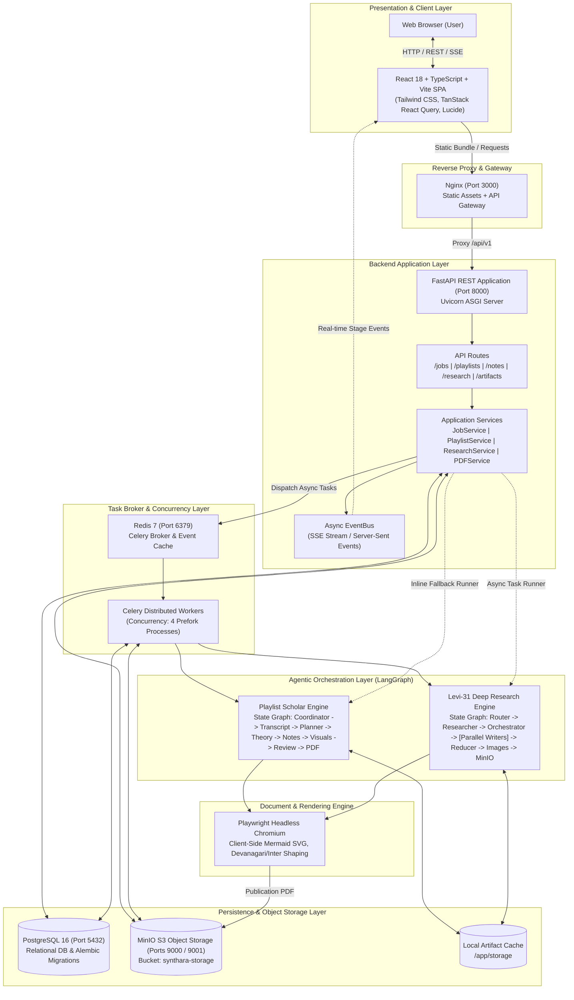
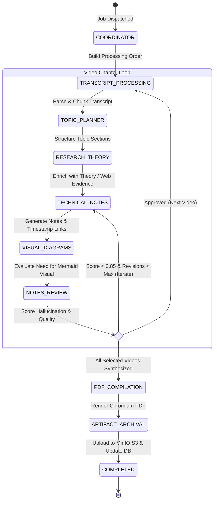
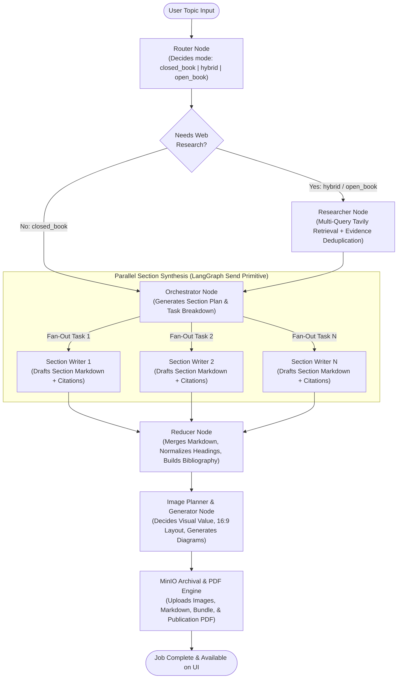
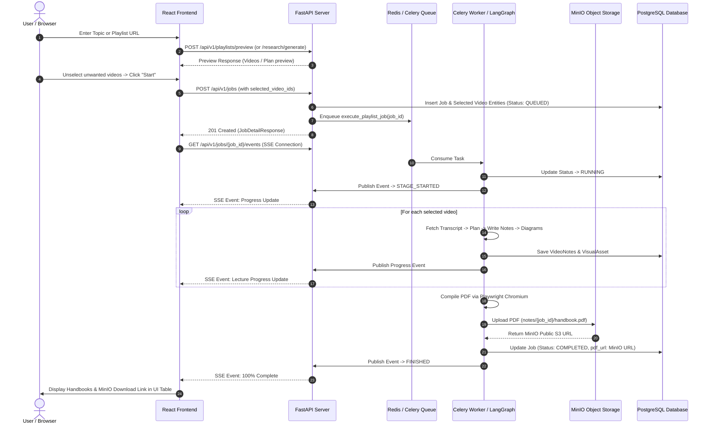
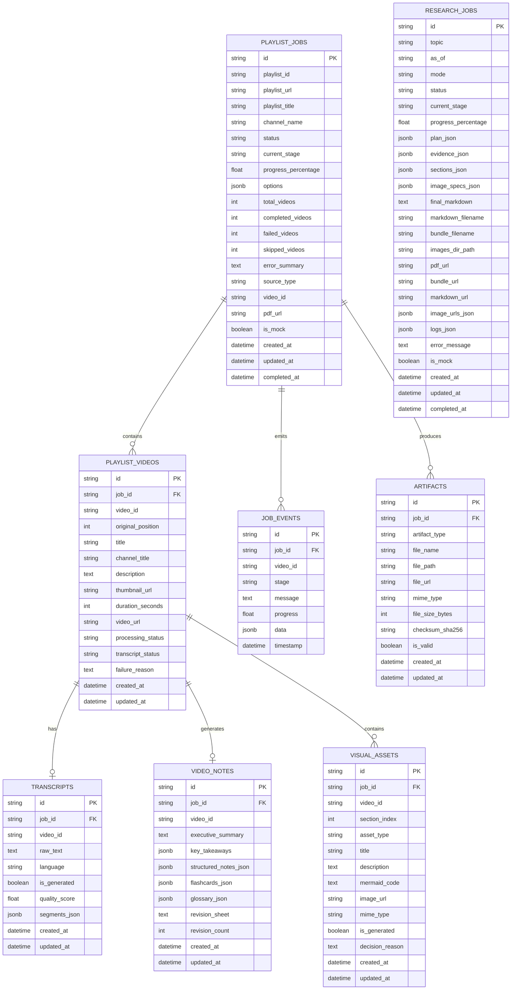
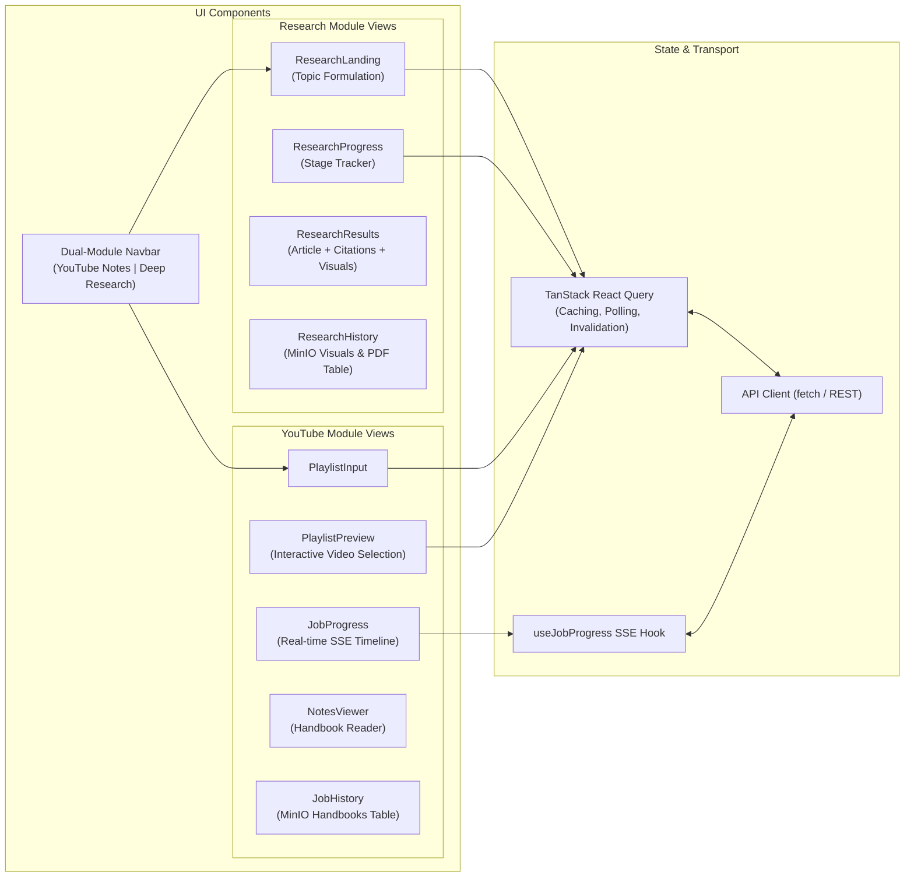

# System Architecture & Technical Specification

## 1. Executive Summary & System Vision

This document details the architectural design, agentic orchestration pipelines, data schemas, Unified Modeling Language (UML) diagrams, and deployment infrastructure of the unified technical intelligence platform.

The system is engineered as a high-throughput, dual-engine technical synthesis platform:

1. **Subsystem A: Playlist Scholar (YouTube Notes & Handbook Synthesis Engine)**  
   Transforms single YouTube videos or multi-lecture YouTube playlists into publication-grade technical handbooks. It executes an agentic LangGraph workflow featuring transcript normalization, semantic chunking, chronological timestamp alignment (`?t=XXs`), theory enrichment, Mermaid diagram generation, hallucination review loops, and pixel-perfect PDF compilation via Playwright Chromium.

2. **Subsystem B: Levi-31 Autonomous Deep Research Module (Research & Synthesis Engine)**  
   An autonomous, multi-agent technical research and publication engine. Given a technical topic, it performs autonomous routing (Closed-Book, Hybrid Search, or Open-Book), parallelized multi-query web retrieval, evidence grounding, dynamic task orchestration, parallel section synthesis via map-reduce fan-out, AI technical diagram generation (16:9 ratio with guaranteed padding), and automated MinIO S3 object storage persistence.

3. **Storage & Media Layer (MinIO + PostgreSQL + Redis)**  
   All generated artifacts (publication-grade PDFs, raw Markdown articles, ZIP bundles, and high-resolution diagrams) are persisted into containerized **MinIO S3 object storage** (`synthara-storage`), with public object URLs indexed in **PostgreSQL 16** and delivered through reactive UI tables with instant modal previews and download links.

---

## 2. High-Level Architecture (C4 Container View)



---

## 3. Subsystem 1: Playlist Scholar (YouTube Notes & Handbook)

### 3.1 Capabilities & Design
- **Single Video & Multi-Video Playlists**: Auto-detects whether the input URL is a standalone video (`youtu.be`, `/watch?v=`, `/shorts/`, `/embed/`) or a complete multi-lecture playlist (`list=...`).
- **Interactive Video Selection**: The frontend curriculum queue allows users to select/deselect specific lectures before generation. Only selected videos are queued, processed, and compiled.
- **Transcript Ingestion Hierarchy**: Tries YouTube Official Captions -> Transcript API -> Auto-generated -> Whisper Transcription -> Mock Fallback.
- **Timestamped Chronology**: Retains segment-level timing markers (`timestamp_seconds`) and automatically transforms them into clickable YouTube links (`https://youtube.com/watch?v=ID&t=124s`).
- **Publication Grade PDF**: Compiles full multi-chapter study guides with an Editorial Navy or Technical Slate theme, interactive Table of Contents, syntax-highlighted code blocks, callouts, and comprehensive revision flashcards.

### 3.2 LangGraph State Machine



### 3.3 Agentic Node Breakdown

| Node Name | Source Module | Primary Responsibility | Input / Output State |
|---|---|---|---|
| `coordinator_node` | `agents/graph.py` | Sets progress bounds, checks inputs, schedules execution plan. | `PlaylistGraphState` $\rightarrow$ Updated execution bounds |
| `transcript_node` | `agents/transcript_agent.py` | Fetches transcripts, validates quality scores, chunks via sliding window, preserves segment IDs. | Raw YouTube Data $\rightarrow$ `Transcript` entity with `segments_json` |
| `topic_planner_node` | `agents/topic_planner_agent.py` | Segments transcript into logical topic boundaries and assigns learning goals. | Transcript Segments $\rightarrow$ High-level Section Plan |
| `research_theory_node` | `agents/research_agent.py` | Resolves complex topics by retrieving verified computer science foundations via Tavily or LLM knowledge. | Section Plan $\rightarrow$ Enriched background & comparison context |
| `technical_notes_node` | `agents/notes_agent.py` | Writes dense technical notes, extracts takeaways, formats code snippets, and resolves timestamp links (`?t=XXs`). | Theory + Transcript $\rightarrow$ `StructuredVideoNotes` |
| `visual_diagram_node` | `agents/visual_agent.py` | Evaluates if visual adds clarity. Generates valid Mermaid syntax (flowcharts, sequence, architecture). Auto-repairs broken fences. | `StructuredVideoNotes` $\rightarrow$ `VisualAsset` (Mermaid code) |
| `notes_review_node` | `agents/review_agent.py` | Evaluates factual grounding against raw transcript, assigns hallucination score, triggers bounded revision loops. | Draft Notes $\rightarrow$ Review score & feedback |
| `pdf_compilation_node` | `services/pdf_service.py` | Compiles Jinja2 templates (`cover`, `toc`, `chapter`, `revision`), renders via Playwright, calculates real TOC page destinations, saves artifact. | All Video Notes $\rightarrow$ Publication PDF |

---

## 4. Subsystem 2: Levi-31 Autonomous Deep Research Module

### 4.1 Capabilities & Design
- **Autonomous Strategy Selection**: Evaluates topic volatility to choose between `closed_book` (theoretical/evergreen), `hybrid` (evergreen + current tools/benchmarks), and `open_book` (news, recent releases, dynamic pricing).
- **Parallel Worker Fan-Out**: Uses LangGraph's dynamic `Send` primitive to dispatch independent research sections to parallel worker tasks, collapsing generation time from minutes to seconds.
- **Strict Citation Grounding**: In `hybrid` and `open_book` modes, statements of fact are strictly linked to verified Evidence URLs `[1]`, `[2]` with domain attribution.
- **Autonomous Technical Visuals**: Evaluates the synthesized content for diagram opportunities. Autonomously writes image generation prompts enforcing a wide 16:9 aspect ratio with $\ge 15\%$ safe padding to avoid cropping.
- **MinIO Storage Pipeline**: All generated images, raw Markdown files, ZIP bundles, and publication PDFs are uploaded to MinIO object storage immediately on completion.

### 4.2 LangGraph Fan-Out Architecture



### 4.3 Deep Research Node Breakdown

| Node Name | Source Module | Model / LLM Strategy | Responsibility |
|---|---|---|---|
| `router` | `modules/research/nodes.py` | Structured Output (`RouterDecision`) | Evaluates prompt intent. Returns mode, `needs_research` boolean, and 3–10 targeted search queries. |
| `researcher` | `modules/research/nodes.py` | Tavily API + Deduplication Logic | Executes parallel web queries, filters by recency (`recency_days`), normalizes ISO publication dates, outputs `EvidenceItem` list. |
| `orchestrator` | `modules/research/nodes.py` | Structured Output (`Plan`) | Produces 5–9 discrete writing tasks with explicit goals, bullet requirements, target word counts, and citation constraints. |
| `section_writer` | `modules/research/nodes.py` | Parallel Worker Fan-Out (`Send`) | Writes one section in GitHub-flavored Markdown. Enforces strict factual grounding against provided evidence. |
| `reducer` | `modules/research/nodes.py` | Deterministic Concatenation | Collects all parallel section outputs in task order, normalizes markdown hierarchy, strips redundant titles, and constructs numbered references. |
| `image_planner_and_generator` | `modules/research/nodes.py` | Structured Output (`GlobalImagePlan`) + DALL-E / Imagen / SVG | Determines where visuals add value. Injects `[[IMAGE_X]]` placeholders, prompts wide 16:9 diagrams with safety padding, and replaces placeholders with rendered images. |
| `archiver` | `modules/research/research_service.py` | MinIO Storage Client + Playwright | Persists all assets to MinIO S3 (`synthara-storage/research/{job_id}/...`), compiles high-res PDF, and updates PostgreSQL database. |

---

## 5. End-to-End Sequence Diagram (Data Flow)



---

## 6. Database Entity-Relationship Diagram (ERD)



---

## 7. Storage Taxonomy & Object Hierarchy (MinIO S3)

The system organizes all binary and structured assets under a deterministic S3 key hierarchy within the `synthara-storage` bucket:

```
synthara-storage/
├── notes/
│   └── {job_id}/
│       └── {slugified_playlist_title}.pdf       <-- Full multi-lecture Handbook PDF
│
└── research/
    └── {research_job_id}/
        ├── {slugified_article_title}.pdf        <-- Publication-grade Research PDF
        ├── {slugified_article_title}.md         <-- Raw Consolidated Markdown Document
        ├── {slugified_article_title}_bundle.zip <-- Complete archive (Markdown + Images)
        └── images/
            ├── {diagram_1_name}.png             <-- Generated 16:9 Diagram Asset
            ├── {diagram_2_name}.png             <-- Generated 16:9 Diagram Asset
            └── ...
```

### Access & URLs
- **Internal Docker Network**: Containers upload via `http://minio:9000`.
- **Public Client Access**: URLs are served as `http://localhost:9000/synthara-storage/...` with `PublicReadGetObject` S3 policies.
- **Resilience**: The storage client implements non-blocking health validation and automatic circuit breaking so that offline storage does not halt job execution.

---

## 8. Frontend Architecture & State Management

The frontend is built with React 18 and TypeScript, styled with Tailwind CSS, and utilizes `@tanstack/react-query` for server-state synchronization:



---

## 9. API Reference & Contract Specification

### 9.1 YouTube Notes API (`/api/v1/jobs` & `/api/v1/playlists`)
| Method | Endpoint | Request Body | Response Model | Description |
|---|---|---|---|---|
| `POST` | `/api/v1/playlists/preview` | `{"playlist_input": string}` | `PlaylistPreviewResponse` | Extracts video list and available lectures from YouTube. |
| `POST` | `/api/v1/jobs` | `CreateJobRequest` (`playlist_input`, `options`, `selected_video_ids`) | `JobDetailResponse` | Creates and queues a new synthesis job for selected lectures. |
| `GET` | `/api/v1/jobs` | Query params: `page`, `page_size` | `JobListResponse` | Paginated history of YouTube synthesis jobs with MinIO links. |
| `GET` | `/api/v1/jobs/{job_id}` | — | `JobDetailResponse` | Live job status, per-video progress, and MinIO PDF URL. |
| `GET` | `/api/v1/jobs/{job_id}/events` | — | SSE Stream (`text/event-stream`) | Real-time Server-Sent Events emitting stage and progress. |
| `GET` | `/api/v1/jobs/{job_id}/notes` | — | `List[StructuredVideoNotes]` | Complete structured notes, flashcards, and glossary items. |
| `GET` | `/api/v1/jobs/{job_id}/download` | — | File Stream (`application/pdf`) | Direct handbook PDF stream (redirects to MinIO if enabled). |

### 9.2 Deep Research API (`/api/v1/research`)
| Method | Endpoint | Request Body | Response Model | Description |
|---|---|---|---|---|
| `POST` | `/api/v1/research/generate` | `CreateResearchJobRequest` (`topic`, `as_of`) | `ResearchJobDetailResponse` | Creates and dispatches autonomous research job. |
| `GET` | `/api/v1/research` | Query params: `page`, `page_size` | `ResearchJobListResponse` | Paginated history table with MinIO images, PDFs, and status. |
| `GET` | `/api/v1/research/{job_id}` | — | `ResearchJobDetailResponse` | Returns active stage, routing decision, evidence, and logs. |
| `GET` | `/api/v1/research/{job_id}/result`| — | `ResearchJobDetailResponse` | Complete synthesized article, plan, citations, and image URLs. |
| `GET` | `/api/v1/research/{job_id}/download/pdf` | — | File Stream (`application/pdf`) | High-res publication PDF with embedded 16:9 diagrams. |
| `GET` | `/api/v1/research/{job_id}/download/markdown` | — | File Stream (`text/markdown`) | Consolidated raw Markdown document with bibliography. |
| `GET` | `/api/v1/research/{job_id}/download/bundle` | — | File Stream (`application/zip`) | Complete archive bundle containing markdown + all images. |
| `GET` | `/api/v1/research/{job_id}/images/{filename}` | — | Image Stream (`image/png`) | Direct proxy endpoint serving generated diagrams. |

---

## 10. Security, Reliability & Quality Assurance

1. **Zero-Hallucination Grounding**:
   - YouTube Notes Agent resolves timestamps strictly from verified segments with active audio/speech text.
   - Deep Research section writers cite verified URLs (`[1]`, `[2]`). Open-book mode forbids claims not backed by fetched evidence snippets.
2. **PostgreSQL 0x00 Byte Sanitization**:
   - Deep research scraping often encounters NUL (`\x00`) characters from raw HTML. All repository writes invoke recursive sanitizers before committing to PostgreSQL.
3. **Mermaid Diagram Auto-Repair**:
   - Fenced code blocks are verified before rendering. Unbalanced quotes, HTML tags in node labels, and trailing truncation are automatically repaired or discarded.
4. **Visual Layout Guarantees**:
   - Prompts mandate 16:9 landscape aspect ratio with $\ge 15\%$ safe margin padding, preventing text cropping or edge clipping.
5. **Circuit-Breaking Storage**:
   - MinIO client utilizes connection pools with strict connection timeouts and automatic availability flags. If MinIO is offline, local disk fallbacks ensure generation never fails.

